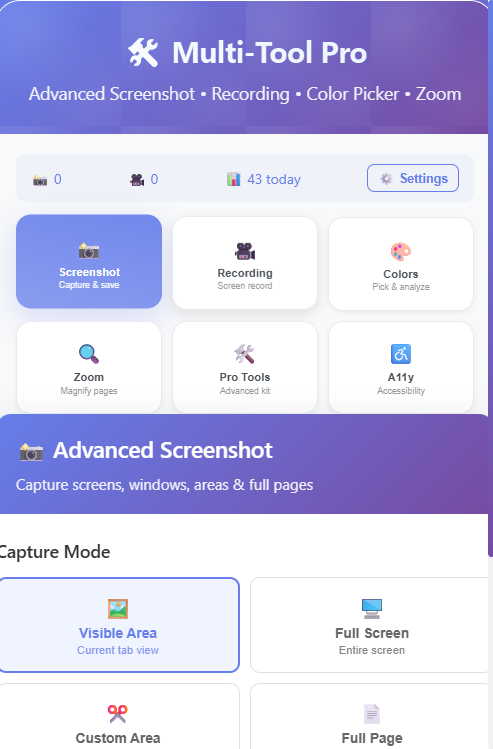

# Multi-Tool Chrome Extension

A comprehensive Chrome extension built with [Plasmo Framework](https://docs.plasmo.com/) that provides four essential tools for web development and productivity:



## 🛠️ Features

### 🎥 Screen Recording

- Record your entire screen, specific windows, or browser tabs
- High-quality video recording with audio support
- Pause/resume functionality during recording
- Automatic download of recorded videos in WebM format
- Real-time duration display

### 📸 Screen Capture (Screenshots)

- Instant screenshot capture of the current tab
- Support for PNG (lossless) and JPEG (compressed) formats
- Adjustable quality settings for JPEG format
- Copy to clipboard or download functionality
- Preview captured screenshots before saving

### 🎨 Color Inspector (Color Picker)

- Real-time color sampling from any element on the page
- Display colors in HEX, RGB, and HSL formats
- Click to copy color values to clipboard
- Color history to track recently picked colors
- Crosshair cursor for precise color selection

### 🔍 Screen Zoom

- Zoom in/out on web pages from 25% to 400%
- Quick preset zoom levels (50%, 75%, 100%, 125%, 150%, 200%)
- Custom zoom slider for precise control
- Keyboard shortcuts support (Ctrl +/-, Ctrl+0)
- One-click zoom reset

## 🚀 Installation

### Development Mode

1. Clone this repository:

```bash
git clone <repository-url>
cd chromeRecording
```

2. Install dependencies:

```bash
pnpm install
# or
npm install
```

3. Start the development server:

```bash
pnpm dev
# or
npm run dev
```

4. Load the extension in Chrome:
   - Open Chrome and go to `chrome://extensions/`
   - Enable "Developer mode" (toggle in top right)
   - Click "Load unpacked"
   - Select the `build/chrome-mv3-dev` folder

### Production Build

```bash
pnpm build
# or
npm run build
```

Then load the `build/chrome-mv3-prod` folder in Chrome.

## 📖 Usage

### Getting Started

1. Click the extension icon in your Chrome toolbar
2. The popup will open with four tabs representing each tool
3. Click on any tab to switch between tools

### 🎥 Screen Recording

1. Click the "Recording" tab
2. Click "Start Recording"
3. Choose what to share (entire screen, window, or tab)
4. Use "Pause/Resume" as needed during recording
5. Click "Stop Recording" to finish and automatically download the video

### 📸 Screen Capture

1. Click the "Screenshot" tab
2. Choose format (PNG for quality, JPEG for smaller files)
3. Adjust quality if using JPEG format
4. Click "Capture Screenshot"
5. Use "Download", "Copy", or "Clear" buttons as needed

### 🎨 Color Inspector

1. Click the "Color Picker" tab
2. Click "Start Color Picker"
3. Move your mouse over any element on the page
4. Click on an element to copy its color to clipboard
5. Press ESC key to exit color picker mode
6. Click on any color value in the popup to copy it

### 🔍 Screen Zoom

1. Click the "Zoom" tab
2. Use quick preset buttons (50%, 75%, 100%, etc.)
3. Or drag the slider for custom zoom levels
4. Use +/- buttons for fine adjustments
5. Click "Reset" to return to 100%

## 🔧 Technical Details

### Built With

- **Plasmo Framework** - Modern browser extension framework
- **React** - UI components and state management
- **TypeScript** - Type safety and better development experience
- **Chrome Extension APIs** - Screen capture, tab management, scripting

### Key APIs Used

- `chrome.desktopCapture` - Screen recording functionality
- `chrome.tabs.captureVisibleTab` - Screenshot capture
- `chrome.scripting` - Content script injection for color picker and zoom
- `MediaRecorder API` - Video recording
- `getDisplayMedia API` - Screen sharing access

### File Structure

```
├── popup.tsx              # Main popup interface
├── background.ts           # Background service worker
├── content.tsx            # Content script for page interaction
├── components/            # React components for each tool
│   ├── ScreenRecorder.tsx
│   ├── ScreenCapture.tsx
│   ├── ColorPicker.tsx
│   └── ScreenZoom.tsx
├── utils/                 # Utility functions
│   ├── mediaUtils.ts
│   └── colorUtils.ts
├── types/                 # TypeScript type definitions
└── styles/                # CSS styles
```

## 🛡️ Permissions

This extension requires the following permissions:

- `activeTab` - Access to the current active tab
- `tabs` - Tab management for screenshots
- `scripting` - Inject scripts for color picker and zoom
- `storage` - Store user preferences
- `desktopCapture` - Screen recording functionality
- `displayCapture` - Screen sharing access

## 🤝 Contributing

1. Fork the repository
2. Create a feature branch (`git checkout -b feature/amazing-feature`)
3. Commit your changes (`git commit -m 'Add amazing feature'`)
4. Push to the branch (`git push origin feature/amazing-feature`)
5. Open a Pull Request

## 📝 License

This project is licensed under the MIT License - see the LICENSE file for details.

## 🙏 Acknowledgments

- Built with [Plasmo Framework](https://docs.plasmo.com/)
- Icons and UI inspired by modern design principles
- Thanks to the Chrome Extensions API documentation

```bash
pnpm build
# or
npm run build
```

This should create a production bundle for your extension, ready to be zipped and published to the stores.

## Submit to the webstores

The easiest way to deploy your Plasmo extension is to use the built-in [bpp](https://bpp.browser.market) GitHub action. Prior to using this action however, make sure to build your extension and upload the first version to the store to establish the basic credentials. Then, simply follow [this setup instruction](https://docs.plasmo.com/framework/workflows/submit) and you should be on your way for automated submission!
